Rust TUIs, Hyprland desktop tooling, extensions for coding agents. Batumi, Georgia.

### Things I built

- **[SSHub](https://sshub.petruha.uk)**: terminal UI for SSH, with SFTP, tunnels and keys
- **[kozyrek](https://github.com/Petyok/kozyrek)** · **[muglock](https://github.com/Petyok/muglock)** · **[hyprswipe](https://github.com/Petyok/hyprswipe)**: Hyprland bar, face unlock, mouse swipes
- **[omp-extensions](https://github.com/Petyok/omp-extensions)**: artifacts and monitors for oh-my-pi
- **[BLAMELESS](https://blameless.petruha.ge)** · **[LIFE³](https://life.petruha.ge)**: playable in the browser

### Upstream

- **[claudexor](https://github.com/razzant/claudexor)**: Cursor CLI detection fix (merged)
- **[oh-my-pi](https://github.com/can1357/oh-my-pi)**: TUI and extension bug reports
- **[vt100-rust](https://github.com/doy/vt100-rust)** · **[shellglass](https://github.com/iksteen/shellglass)**: parser performance and panic reports
- **[Optimum](https://github.com/StratumServer/Optimum)**: crash and Linux install reports
